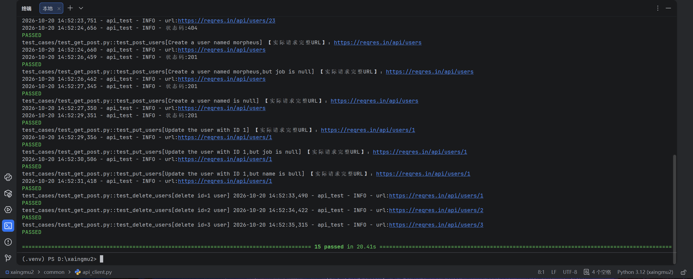
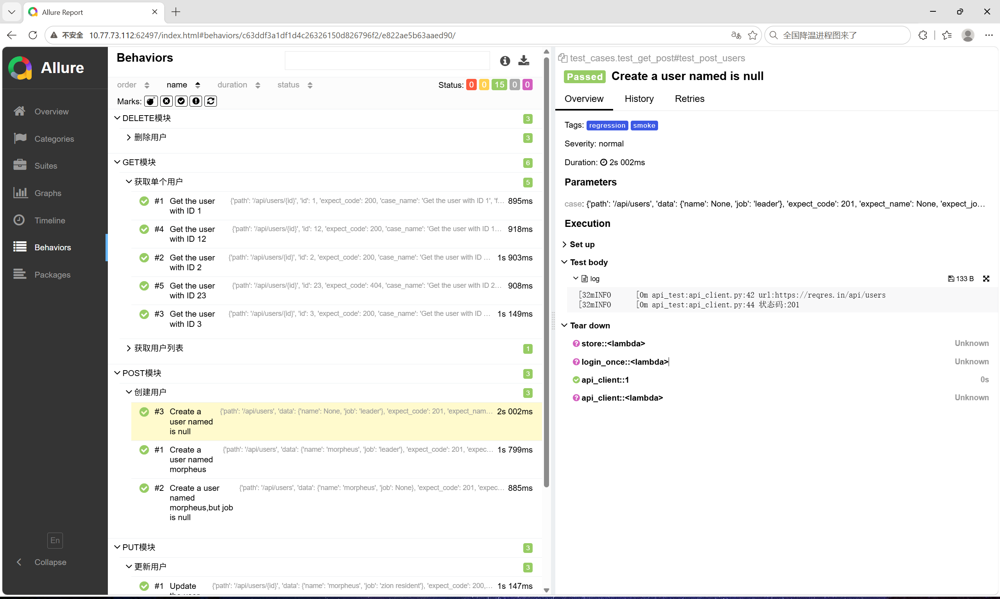

# 用户管理系统接口自动化测试框架（Pytest + Requests + Allure）

## 一、项目简介
基于 Python + Pytest + Requests 实现的 HTTP 接口自动化测试框架，对用户管理模块（注册登录、用户增删改查）进行自动化回归测试。采用**用例与代码分离**的设计：测试数据维护在 YAML 中，通过 `@pytest.mark.parametrize` 数据驱动执行；封装统一的 HTTP 请求客户端与断言工具，支持登录鉴权关联、失败重跑、可视化报告。

被测对象为公开测试接口服务 ReqRes（https://reqres.in）。

## 二、技术栈
| 类别 | 技术 |
|---|---|
| 语言 | Python 3.12 |
| 测试框架 | Pytest 9.x（fixture / parametrize / marker） |
| HTTP 请求 | Requests 2.x |
| 数据驱动 | PyYAML（YAML 管理用例） |
| 测试报告 | Allure-pytest（分层 feature/story/title） |
| 失败重跑 | pytest-rerunfailures |
| 日志 | logging（控制台 + 文件双输出） |
| 版本管理 | Git |

## 三、项目亮点
- **数据驱动**：用例数据与脚本分离，YAML 维护路径、入参、预期结果，新增用例只改数据不改代码
- **接口关联**：session 级 fixture 自动登录并提取 token 存入共享容器，供后续鉴权用例复用；登录失败/限流时容错跳过，不中断整体执行
- **分层封装**：common 目录统一封装请求客户端、断言工具、日志、Allure、YAML 读取，复用性强
- **正反兼顾**：覆盖正向成功、404 反向、null 空值边界、204 无响应体等多种场景
- **可视化报告**：Allure 按模块（feature）/功能点（story）/用例标题分层展示，支持日志与结果追溯
- **用例分级**：smoke（冒烟）/ regression（回归）marker，可按需筛选执行

## 四、目录结构
```
├── common/                 # 公共封装模块
│   ├── api_client.py       # HTTP 请求封装（GET/POST/PUT/DELETE），代理开关
│   ├── assert_util.py      # 通用断言（状态码、JSON字段，含容错取响应体）
│   ├── yaml_util.py         # YAML 读取与用例/ids 提取
│   ├── allure_util.py       # Allure 动态标题/feature/story
│   └── logger.py           # 日志封装（控制台 + 文件）
├── config/
│   └── config.py           # 全局配置（base_url、timeout）
├── data/
│   └── get_data.yaml       # 全部测试用例数据
├── test_cases/
│   └── test_get_post.py    # CRUD 测试用例
├── logs/                   # 运行日志（已 git 忽略）
├── reports/                # Allure 报告（已 git 忽略）
├── conftest.py             # session 级 fixture、自动登录
├── pytest.ini               # pytest 配置（addopts、markers）
├── requirements.txt        # 依赖清单
└── .gitignore
```

## 五、用例覆盖
| 模块 | 接口 | 场景 |
|---|---|---|
| GET | /api/users | 用户列表分页，断言总数 |
| GET | /api/users/{id} | 查询单个用户（存在）；id=23 验证 404 反向 |
| POST | /api/users | 创建用户；job=null、name=null 空值边界，断言返回字段 |
| PUT | /api/users/{id} | 更新用户；job=null、name=null 边界 |
| DELETE | /api/users/{id} | 删除用户，断言 204 No Content |
| 鉴权 | /api/login | 自动登录提取 token（接口关联） |

## 六、环境安装
```bash
# 1. 创建虚拟环境（Windows）
python -m venv .venv

# 2. 激活虚拟环境（Windows）
.venv\Scripts\activate

# 3. 安装依赖
pip install -r requirements.txt

# 4. 运行测试
pytest
```
> Mac/Linux 激活命令：`source .venv/bin/activate`
> Allure 报告需额外安装 Allure 命令行（Java 环境），不装也可用 pytest 控制台结果。
> 被测接口 ReqRes 为外部免费测试服务，偶尔限流（403/429）属正常现象，稍等重试即可，不影响框架本身。

## 七、运行方式
```bash
# 全量执行（pytest.ini 已自动指定报告输出目录）
pytest

# 只跑冒烟用例
pytest -m smoke -v

# 只跑回归用例
pytest -m regression -v

# 按关键字筛选
pytest -k "post" -v
```

## 八、生成 Allure 报告
```bash
# 1. 执行用例，结果输出到 reports/allure（pytest.ini 已配置）
pytest

# 2. 生成 HTML 报告
allure generate reports/allure -o reports/html --clean

# 3. 本地打开
allure open reports/html
```

## 九、报告截图

